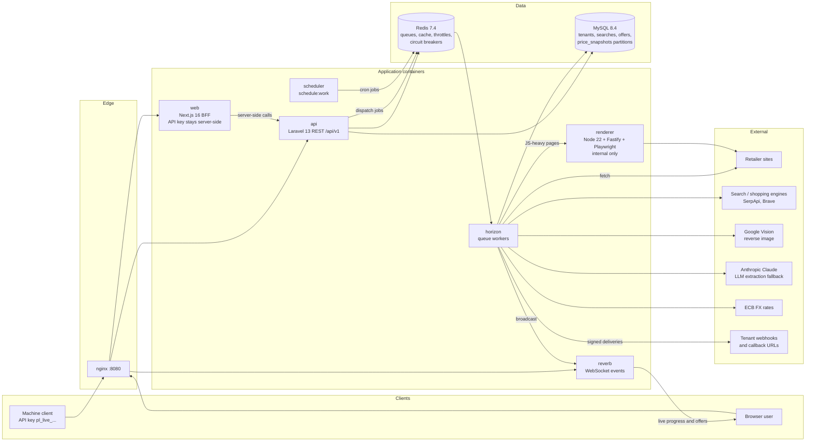
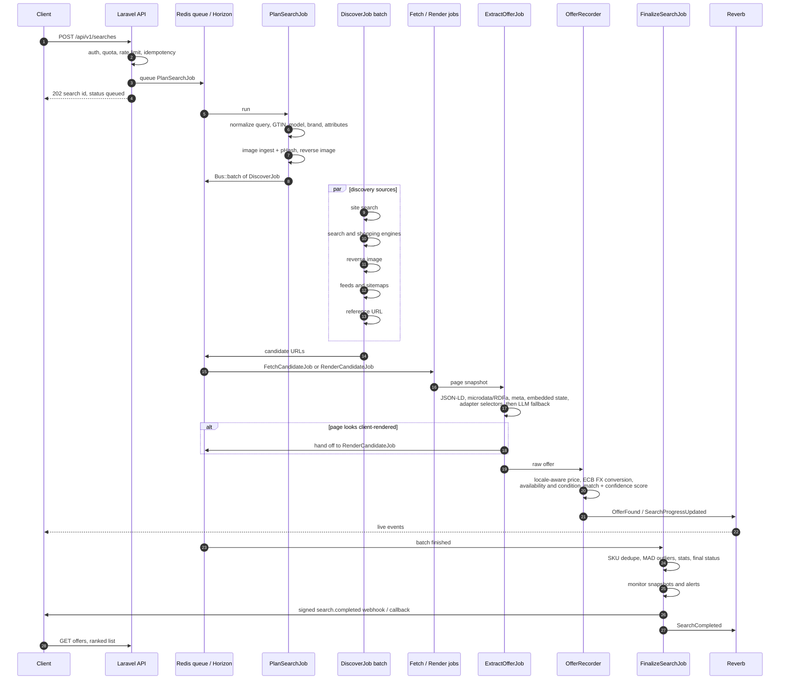
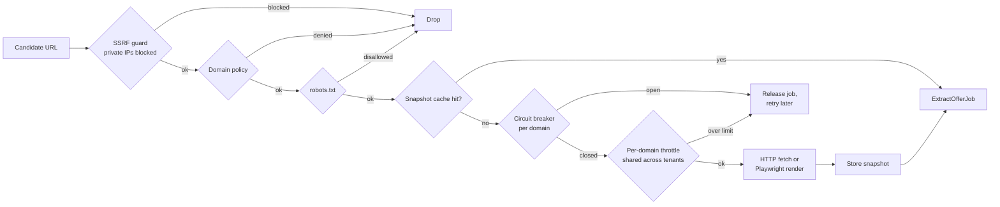
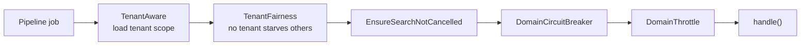
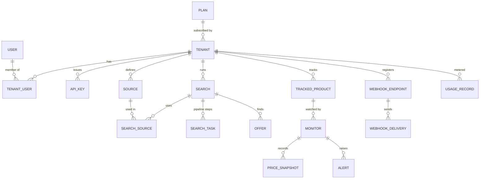
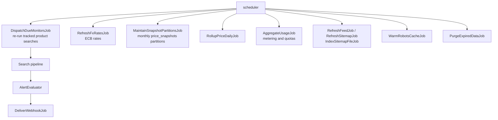

# PriceLens Architecture

PriceLens is a multi-tenant price-intelligence service. A client sends a product (title, image, GTIN/UPC/EAN,
MPN, brand or a reference URL). PriceLens finds matching listings on tenant-defined sites and search engines,
extracts and normalizes the offers, scores each match, and returns a ranked list. Results come back through the
REST API, signed webhooks and Reverb real-time events.

## 1. System overview

## 2. How a search flows

## 3. The fetch guard chain

Every candidate URL passes these checks before it is fetched. A failed check stops the fetch or puts the job back
on the queue.

## 4. Queue job middleware

Every pipeline job runs through this middleware stack in order.

## 5. Core data model

## 6. Background and scheduled work

