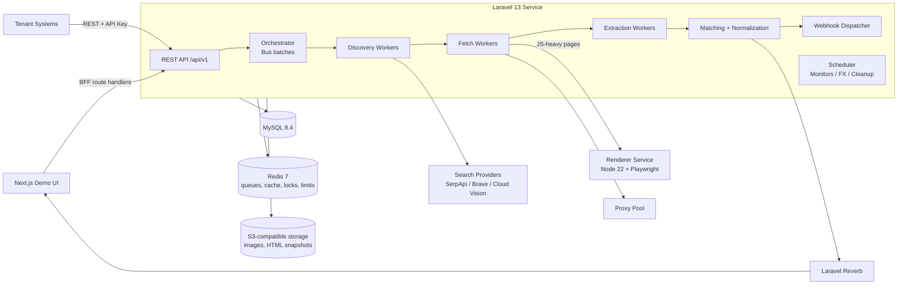
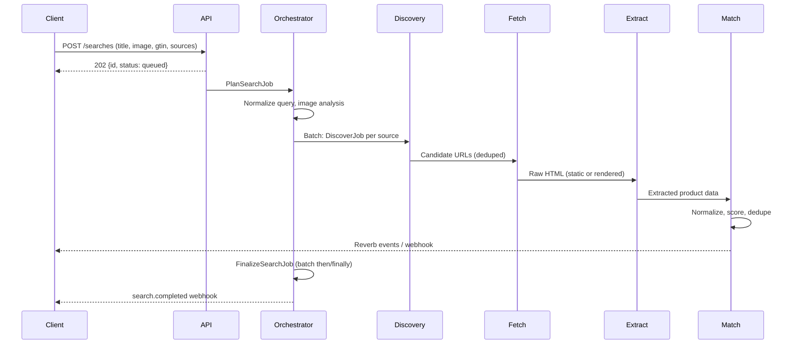

# PriceLens — Multi-Tenant Product Price Intelligence Microservice

## 1. Purpose

PriceLens takes a product described by any combination of **title, image, GTIN/UPC/EAN, MPN, brand, or reference URL**, discovers matching listings across **tenant-defined websites and/or search engines**, extracts **price, currency, availability, shipping, seller, and URL**, matches and scores each listing against the input product, and returns a normalized, ranked offer list via a **REST API**, **webhooks**, and **real-time events**. A **Next.js demo UI** consumes the same public API.

### Goals

- Multi-tenant SaaS: strict data isolation, per-tenant sources, quotas, credentials, and webhooks.
- Async, horizontally scalable scraping pipeline.
- Pluggable discovery (sites, search engines, shopping engines, reverse image search, merchant feeds).
- Deterministic structured-data extraction first, configurable selectors second, LLM extraction last (feature-flagged).
- Product matching with an explainable confidence score.
- One-off searches and scheduled monitoring (price history, price-drop alerts, MAP violation detection).

### Non-Goals

- CAPTCHA solving, login-wall bypass, or circumvention of technical access controls.
- Checkout/cart automation.
- Guaranteeing real-time prices (results are point-in-time snapshots with `observed_at`).

---

## 2. Architecture



### Components

| Component | Responsibility |
|---|---|
| **API (Laravel)** | Auth, tenancy resolution, validation, authorization, search creation, results, sources, monitors, webhooks, usage. |
| **Orchestrator** | Builds a search plan, fans out tasks with `Bus::batch`, tracks progress, finalizes results. |
| **Discovery workers** | Turn the input product into candidate product URLs (site search, search engines, shopping engines, reverse image search, feeds). |
| **Fetch workers** | Polite HTTP fetching: robots.txt, per-domain throttling, proxy rotation, retries, SSRF guard; delegate to Renderer when required. |
| **Renderer service** | Stateless Node/Playwright service that returns rendered HTML for JS-driven pages. Internal network only. |
| **Extraction workers** | JSON-LD → Microdata/RDFa → OpenGraph product meta → source selectors → LLM fallback. |
| **Matching / normalization** | Price parsing, currency conversion, availability mapping, confidence scoring, dedupe, ranking. |
| **Webhook dispatcher** | Signed, retried, logged deliveries. |
| **Scheduler** | Monitor runs, FX rate refresh, robots.txt cache warmup, data retention, source health checks. |
| **Reverb** | Pushes search progress and offers to the UI in real time. |

---

## 3. Tech Stack

| Layer | Choice |
|---|---|
| API / workers | Laravel 13, PHP 8.4, PHP-FPM |
| Queues | Redis + Laravel Horizon |
| Real-time | Laravel Reverb + Laravel Echo |
| Auth | Sanctum (dashboard users), hashed tenant API keys (machine clients) |
| Feature flags | Laravel Pennant (per-tenant scope) |
| HTML parsing | `symfony/dom-crawler`, `symfony/css-selector` |
| robots.txt | `spatie/robots-txt` |
| Money | `brick/money` |
| Image hashing | `jenssegers/imagehash` (perceptual hash) |
| Database | MySQL 8.4 LTS |
| Storage | S3-compatible (AWS S3 / MinIO) |
| Renderer | Node.js 22, TypeScript, Fastify, Playwright (Chromium) |
| Demo UI | Next.js 16 (App Router), TypeScript, Tailwind CSS v4, TanStack Query, Recharts, `laravel-echo` + `pusher-js` |
| Testing | Pest (PHP), Vitest + Playwright Test (UI), HTML fixture golden tests |
| Observability | OpenTelemetry, Prometheus metrics endpoint, Sentry, structured JSON logs |
| Runtime | Docker, Nginx reverse proxy, Ubuntu 24.04 hosts |

---

## 4. Multi-Tenancy

### Model

**Single database, shared schema, `tenant_id` on every tenant-owned table.** This keeps migrations, cross-tenant analytics, and operations simple while scaling to thousands of tenants. Isolation is enforced at four layers:

1. **Resolution** — `ResolveTenant` middleware resolves the tenant from the API key (machine) or the authenticated user's current tenant (dashboard). Tenant is bound into the container as `CurrentTenant`.
2. **Query scoping** — `BelongsToTenant` trait adds a global scope (`where tenant_id = ?`) and auto-fills `tenant_id` on create. Any query without a resolved tenant throws.
3. **Authorization** — Policies verify `$model->tenant_id === CurrentTenant::id()` as defense-in-depth against `withoutGlobalScopes()` misuse.
4. **Async context** — Every job carries `tenantId`; a `TenantAware` job middleware re-binds `CurrentTenant` before `handle()` and clears it after.

Storage paths, cache keys, Redis rate-limit keys, and Reverb channels are all prefixed with `tenant:{id}`.

### Per-Tenant Configuration

- Sources (sites, engines, feeds) and selector adapters.
- Domain allowlist / blocklist.
- Default country, language, currency.
- BYO proxy credentials and BYO search-provider API keys (encrypted casts).
- Webhook endpoints and secrets.
- Plan limits and feature flags (LLM extraction, image search, monitors).
- Data retention period.

### Plans & Quotas

| Limit | Enforcement |
|---|---|
| Searches / month | Checked at `POST /searches`; `429` with `quota_exceeded` |
| Concurrent searches | Redis counter per tenant |
| Max sources per search | Request validation |
| Max results per search | Request validation |
| Active monitors | Checked at monitor create/activate |
| Render (browser) pages / month | Metered per render call |
| Search-provider calls / month | Metered per provider call |
| API rate limit (req/min) | `RateLimiter::for('api')` keyed by tenant |

Usage is written to `usage_records` (append-only) and aggregated hourly into `usage_daily`.

---

## 5. Core Concepts

| Concept | Description |
|---|---|
| **Search** | A one-off request to find offers for a product. Async; has status and progress. |
| **Product Query** | Normalized input: title, tokens, brand, model, GTIN, MPN, image hash, inferred attributes. |
| **Source** | Where to look: a site adapter, a search engine, a shopping engine, a reverse image provider, or a merchant feed. |
| **Task** | One unit of work for a source within a search (discover / fetch / extract). |
| **Candidate** | A discovered URL that might be a matching product page. |
| **Offer** | An extracted, normalized, scored listing: price, currency, site, URL, availability, confidence. |
| **Tracked Product** | A tenant's catalog item that is monitored on a schedule. |
| **Monitor** | Schedule + sources + alert rules attached to a tracked product. |
| **Price Snapshot** | Historical price point for a tracked product on a given site. |

---

## 6. Scraping Pipeline



### 6.1 Stage 1 — Query Normalization (`PlanSearchJob`)

- Clean title: lowercase, strip marketing noise ("new", "free shipping", "2024 model"), normalize units (`1TB` ↔ `1 TB`), collapse whitespace.
- Extract identifiers with validators:
  - GTIN-8/12/13/14 with check-digit validation.
  - Model / MPN via pattern rules (alphanumeric tokens with digits, e.g. `WH-1000XM5`).
  - Brand via tenant brand dictionary + global dictionary.
- Image input (upload or URL):
  - SSRF-guarded download, MIME + magic-byte validation, max 10 MB, re-encode to WebP, store at `tenants/{id}/searches/{search}/input.webp`.
  - Compute perceptual hash (pHash) for later image matching.
  - If image search is enabled: call reverse image provider to obtain visual matches (URLs, titles) and best-guess labels.
  - If no title supplied, derive one from best-guess label + top visual-match titles.
- Persist `product_query` JSON on the search.
- Build the **search plan**: list of `(source, strategy, query_variants)`.

Query variants generated per plan (bounded by `max_query_variants`, default 3):

1. GTIN alone (highest precision).
2. `brand + model`.
3. Cleaned title.

### 6.2 Stage 2 — Discovery (`DiscoverJob`, queue `discovery`)

| Source type | Strategy |
|---|---|
| `site` | Use the adapter's `search_url_template` (e.g. `https://shop.example.com/search?q={query}`), fetch, extract product links with `listing.item_link` selector. Optionally extract price directly from listing cards (`listing_mode: true`) to skip product-page fetches. |
| `search_engine` | Provider query restricted per allowed domain (`site:shop.example.com {query}`) or open web if `scope: open`. Filter results by domain allow/blocklist. |
| `shopping_engine` | Provider shopping results return title, price, merchant, link directly. These become offers immediately and optionally get verified by fetching the merchant page (`verify: true`). |
| `reverse_image` | Visual-match page URLs from the image provider become candidates. |
| `feed` | Tenant-supplied merchant feed (CSV/XML in Google Merchant feed format) indexed periodically; matched by GTIN/MPN/title without fetching. |

Candidates are normalized (canonical URL, tracking params stripped: `utm_*`, `gclid`, `fbclid`, `ref`, etc.), deduplicated per search with a Redis set, and capped per source (`max_candidates_per_source`, default 10).

### 6.3 Stage 3 — Fetching (`FetchCandidateJob`, queues `fetch` / `render`)

Order of operations per URL:

1. **SSRF guard** — resolve DNS, reject private/loopback/link-local/metadata ranges (`10/8`, `172.16/12`, `192.168/16`, `127/8`, `169.254/16`, `::1`, `fc00::/7`, `fe80::/10`), reject non-`http(s)` schemes, re-check on every redirect (max 5).
2. **Policy check** — domain allowlist/blocklist, global `domain_policies` (e.g. domains that requested exclusion).
3. **robots.txt** — fetched and cached 24h per host; disallowed paths are skipped and recorded as `skipped_robots`.
4. **Cache** — if a fresh HTML snapshot exists for the canonical URL within the tenant's `cache_ttl`, reuse it.
5. **Throttle** — `Redis::throttle("domain:{host}")` with per-domain concurrency and rate (default 1 req / 2 s, overridable per source and per `domain_policies`). Jobs release back to the queue with jitter when throttled.
6. **Fetch** — Laravel HTTP client (Guzzle): realistic `Accept`/`Accept-Language` headers, identifying `User-Agent` configurable per tenant, gzip/br, 15 s timeout, 2 MB body cap, proxy from pool (tenant BYO pool first, platform pool second).
7. **Render decision** — adapter `render: never | auto | always`.
   - `auto`: if static extraction yields no price and page heuristics indicate client rendering (empty root container, `__NEXT_DATA__` without offers, high script-to-text ratio), dispatch `RenderCandidateJob` to the `render` queue.
8. **Retry policy** — retry on `429`, `502`, `503`, `504`, timeouts with exponential backoff (`[10, 30, 90]` s), honoring `Retry-After`. `403` / `401` are terminal → `blocked`. Circuit breaker opens per domain after N consecutive failures (default 10 in 5 min) and short-circuits further tasks for 15 min.
9. **Snapshot** — compressed HTML stored to S3 (`tenants/{id}/snapshots/{sha1(url)}/{timestamp}.html.gz`) for debugging, re-extraction, and fixture creation; retention per plan.

#### Renderer Service API (internal only)

```
POST /render
{
  "url": "https://shop.example.com/p/123",
  "wait_until": "networkidle",
  "wait_for_selector": "[data-testid=price]",
  "timeout_ms": 20000,
  "proxy": { "server": "http://host:port", "username": "...", "password": "..." },
  "block_resources": ["image", "media", "font"],
  "viewport": { "width": 1366, "height": 900 },
  "locale": "en-US",
  "screenshot": false
}

200
{
  "final_url": "https://shop.example.com/p/123",
  "status": 200,
  "html": "<!doctype html>...",
  "timing_ms": 3120,
  "screenshot_base64": null
}
```

- Browser pool: a fixed number of Chromium instances; each request gets a fresh `BrowserContext` (no cookie/state leakage between tenants).
- Concurrency limit per instance; returns `503` when saturated so the Laravel job releases and retries.
- Authenticated with an internal shared token; not exposed publicly.

### 6.4 Stage 4 — Extraction (`ExtractOfferJob`, queue `extract`)

Extractors run in a chain; each returns a partial `ExtractedProduct` DTO with a per-field `source` marker. Fields are merged with priority, so a later extractor fills only missing fields.

| Priority | Extractor | Notes |
|---|---|---|
| 1 | **JSON-LD** | `schema.org/Product` with `offers` (`Offer` / `AggregateOffer`), handles `@graph`, arrays, nested `ProductGroup` / `hasVariant`. |
| 2 | **Microdata / RDFa** | `itemtype=schema.org/Product`, `itemprop=price`, `priceCurrency`, `availability`. |
| 3 | **Meta tags** | `product:price:amount`, `product:price:currency`, `og:price:amount`, `og:price:currency`, `og:title`, `og:image`. |
| 4 | **Embedded state** | Known framework payloads (`__NEXT_DATA__`, `window.__INITIAL_STATE__`) via JSON paths defined in the adapter. |
| 5 | **Adapter selectors** | Per-source CSS/XPath selectors with optional regex post-processing. |
| 6 | **LLM fallback** | Pennant flag `llm-extraction`. Cleaned visible text (nav/footer/scripts removed, truncated) sent to the Anthropic Messages API with a strict JSON-only instruction; output validated against a schema; marked `extraction_method = llm` and capped at 0.9 field-confidence. |

Extracted fields:

`title, brand, gtin, mpn, sku, model, image_url, price, sale_price, list_price, currency, availability, condition, seller_name, shipping_price, shipping_currency, rating, review_count, variant_attributes (color, size, storage), canonical_url`

Extraction failures are recorded with a reason (`no_price_found`, `parse_error`, `blocked`, `not_product_page`) to feed source health metrics.

### 6.5 Stage 5 — Normalization

- **Price parsing** — locale-aware: `1.299,00 €`, `€1,299.00`, `1 299,00`, `Rs. 1,29,999`, `¥12,800`; uses currency minor-unit precision (`JPY` = 0, `KWD` = 3). Stored as `BIGINT` minor units + `CHAR(3)` ISO 4217.
- **Effective price** — `sale_price ?? price`; `total_price = effective + shipping` when shipping is known.
- **Currency conversion** — daily ECB reference rates (`fx_rates` table), cross rates via EUR; every offer stores original and `converted_price_minor` in the search's target currency plus the `fx_rate_date` used.
- **Availability mapping** — schema.org values and site text normalized to `in_stock | out_of_stock | preorder | backorder | limited | discontinued | unknown`.
- **Condition** — `new | refurbished | used | unknown`.
- **Sanity checks** — reject prices `<= 0`; flag outliers beyond `median ± 3 × MAD` of the result set as `price_outlier = true` (kept but de-ranked; typical of accessories or bundles).

### 6.6 Stage 6 — Matching & Scoring

Each offer receives a `match_confidence` (0–1) and a `match_breakdown` JSON for explainability.

**Short-circuits**

- GTIN on page equals query GTIN → `1.0`, `match_type = exact_gtin`.
- GTIN on page present and **different** from query GTIN → `0.0`, `match_type = mismatch_gtin`.

**Weighted score otherwise**

| Signal | Weight | Method |
|---|---|---|
| Title similarity | 0.40 | Token-set ratio on normalized tokens + numeric/unit token agreement bonus/penalty |
| Model / MPN match | 0.20 | Exact normalized equality (hyphens/spaces removed); partial prefix = 0.5 |
| Brand match | 0.15 | Exact or alias dictionary |
| Image similarity | 0.15 | pHash Hamming distance → similarity (only when both images available) |
| Variant agreement | 0.10 | Storage, size, color, pack quantity |

Weights are re-normalized over available signals. **Hard negatives** multiply the score by 0.3: accessory keywords not in the query (`case`, `cover`, `replacement`, `strap`, `charger for`), conflicting storage/size values, `used`/`refurbished` when the search requests `condition=new`.

| Band | Range | Default handling |
|---|---|---|
| `exact` | ≥ 0.85 | Included |
| `likely` | 0.60 – 0.85 | Included |
| `possible` | 0.40 – 0.60 | Included only if `include_possible=true` |
| `rejected` | < 0.40 | Stored, hidden from results |

Thresholds are tenant-configurable.

### 6.7 Stage 7 — Dedupe, Rank, Finalize

- Dedupe key: `(site_domain, canonical_url)`; secondary key `(site_domain, sku)`.
- Ranking (default): `match_band DESC, availability (in_stock first), converted_total_price ASC`. Supported sorts: `price`, `total_price`, `confidence`, `site`, `observed_at`.
- Summary stats computed on `exact + likely` in-stock offers: `min`, `max`, `median`, `mean`, `p25`, `p75`, `offer_count`, `site_count`, cheapest offer reference.
- `FinalizeSearchJob` (batch `finally`) sets `completed` or `partially_completed` (some tasks failed), writes stats, emits `search.completed`.

---

## 7. Source Configuration

### Source Types

| `type` | Required config |
|---|---|
| `site` | `domain`, `search_url_template` and/or `product_url_patterns`, optional selectors |
| `search_engine` | `provider`, `scope` (`allowed_domains` / `open`), `country`, `language` |
| `shopping_engine` | `provider`, `country`, `language`, `verify` |
| `reverse_image` | `provider` |
| `feed` | `feed_url` or upload, `format`, `refresh_interval` |

### Site Adapter Example

```json
{
  "name": "Example Electronics",
  "type": "site",
  "domain": "shop.example.com",
  "country": "US",
  "currency": "USD",
  "enabled": true,
  "render": "auto",
  "rate_limit": { "requests": 1, "per_seconds": 3, "concurrency": 2 },
  "search_url_template": "https://shop.example.com/search?q={query}",
  "product_url_patterns": ["^https://shop\\.example\\.com/p/[\\w-]+"],
  "listing": {
    "item": ".product-grid .product-card",
    "item_link": "a.product-card__link@href",
    "item_title": ".product-card__title",
    "item_price": ".product-card__price",
    "listing_mode": false
  },
  "product": {
    "title": "h1.product-title",
    "price": "[data-testid=price-current]",
    "list_price": "[data-testid=price-was]",
    "currency": { "static": "USD" },
    "availability": ".stock-status",
    "gtin": { "selector": "script[type='application/ld+json']", "json_path": "$.gtin13" },
    "image": "meta[property='og:image']@content",
    "price_regex": "([0-9.,]+)"
  },
  "embedded_state": {
    "script_selector": "script#__NEXT_DATA__",
    "price_path": "$.props.pageProps.product.price.value",
    "currency_path": "$.props.pageProps.product.price.currency"
  },
  "headers": { "Accept-Language": "en-US,en;q=0.9" }
}
```

Selector syntax: CSS by default, `xpath:` prefix for XPath, `@attr` suffix to read an attribute.

### Global Adapter Library

Platform-maintained adapters (`tenant_id = NULL`, `is_global = true`) for common storefront platforms; tenants can enable them or **fork** them into tenant-owned copies. Tenant adapters always take precedence on the same domain.

### Source Health

- Rolling metrics per source: fetch success rate, extraction success rate, median latency, block rate.
- Health status: `healthy | degraded | failing`. Transition to `failing` (extraction success < 50% over the last 50 tasks) emits `source.degraded` webhook and auto-pauses global adapters pending review.
- `POST /sources/{id}/test` runs the adapter against a supplied URL or query and returns the extracted fields, raw selector hits, and timing — used by the UI adapter editor.

---

## 8. Search Providers

Abstraction:

```php
interface SearchProvider
{
    public function search(ProviderQuery $query): ProviderResultCollection;
    public function capabilities(): ProviderCapabilities; // web, shopping, reverse_image, site_filter
}
```

Drivers (configured globally, overridable with tenant BYO keys):

| Driver | Capabilities | Notes |
|---|---|---|
| `serpapi` | web (`engine=google`), shopping (`engine=google_shopping`), reverse image (`engine=google_lens`) | Paid third-party SERP API. |
| `brave` | web | Brave Search API. |
| `google_vision` | reverse image | Cloud Vision `WEB_DETECTION`: `pagesWithMatchingImages`, `webEntities`, `bestGuessLabels`. |

Provider results are cached per tenant by `sha1(provider + normalized_query + country + language)` for `provider_cache_ttl` (default 6 h) to control cost.

> **Verify before implementation:** Bing Web/Visual Search APIs were retired in 2025 and are intentionally excluded. Google's Custom Search JSON API has announced restrictions for new customers; it is excluded. Confirm current pricing, quotas, and terms for each listed provider at build time.

---

## 9. Data Model (MySQL 8.4)

All tenant-owned tables include `tenant_id BIGINT UNSIGNED NOT NULL` with a composite index leading with `tenant_id`. Public identifiers are ULIDs (`CHAR(26)`); internal PKs are `BIGINT UNSIGNED AUTO_INCREMENT`. Timestamps are UTC.

### Tenancy & Access

| Table | Key columns |
|---|---|
| `tenants` | `id, ulid, name, slug UNIQUE, plan_id, status (active/suspended), default_country, default_language, default_currency, settings JSON, retention_days, created_at, updated_at` |
| `plans` | `id, code UNIQUE, name, limits JSON, features JSON` |
| `users` | `id, ulid, name, email UNIQUE, password, current_tenant_id, ...` |
| `tenant_user` | `tenant_id, user_id, role (owner/admin/member/viewer)`, PK `(tenant_id, user_id)` |
| `api_keys` | `id, tenant_id, name, prefix CHAR(8), key_hash CHAR(64) UNIQUE, abilities JSON, last_used_at, expires_at, revoked_at` |
| `audit_logs` | `id, tenant_id, actor_type, actor_id, action, subject_type, subject_id, ip, metadata JSON, created_at` |

API key format: `pl_live_{prefix}_{secret}`; only `sha256` of the secret is stored; prefix enables lookup and display.

### Sources

| Table | Key columns |
|---|---|
| `sources` | `id, ulid, tenant_id NULL, is_global, type, name, domain, country, currency, config JSON, render ENUM, enabled, health_status, forked_from_id, created_at, updated_at` — index `(tenant_id, type, enabled)`, `(domain)` |
| `source_health_stats` | `source_id, window_start, fetch_ok, fetch_fail, extract_ok, extract_fail, blocked, p50_ms` |
| `domain_policies` | `id, tenant_id NULL, domain, policy (allow/block/throttle), rate_limit JSON, reason` |
| `provider_credentials` | `id, tenant_id, provider, credentials TEXT (encrypted cast)` |
| `proxy_pools` | `id, tenant_id NULL, name, proxies TEXT (encrypted), country, type (datacenter/residential)` |

### Searches & Results

| Table | Key columns |
|---|---|
| `searches` | `id, ulid, tenant_id, monitor_id NULL, status, input JSON, product_query JSON, options JSON, target_currency CHAR(3), country, progress_total, progress_done, stats JSON, error, idempotency_key, started_at, completed_at, created_at` — unique `(tenant_id, idempotency_key)`, index `(tenant_id, status, created_at)` |
| `search_sources` | `search_id, source_id, status, candidates_found, offers_found, error` |
| `search_tasks` | `id, search_id, tenant_id, source_id, stage (discover/fetch/render/extract), url, url_hash CHAR(40), status, attempts, http_status, error_code, duration_ms, created_at` — index `(search_id, stage, status)` |
| `offers` | `id, ulid, tenant_id, search_id, source_id NULL, site_domain, site_name, url, url_hash CHAR(40), title, brand, gtin, mpn, sku, image_url, price_minor BIGINT, list_price_minor, shipping_minor, currency CHAR(3), converted_price_minor, converted_total_minor, fx_rate_date, availability, condition, seller_name, rating DECIMAL(3,2), review_count, variant JSON, match_confidence DECIMAL(4,3), match_band, match_breakdown JSON, extraction_method, price_outlier, snapshot_path, observed_at` — unique `(search_id, url_hash)`, index `(tenant_id, search_id, match_band, converted_total_minor)` |

### Monitoring

| Table | Key columns |
|---|---|
| `tracked_products` | `id, ulid, tenant_id, external_ref, title, brand, gtin, mpn, image_path, image_phash, reference_price_minor, map_price_minor, currency, attributes JSON, archived_at` — unique `(tenant_id, external_ref)` |
| `monitors` | `id, ulid, tenant_id, tracked_product_id, schedule (cron), timezone, source_ids JSON, options JSON, alert_rules JSON, status, next_run_at, last_run_at` — index `(status, next_run_at)` |
| `price_snapshots` | `id, tenant_id, tracked_product_id, site_domain, url_hash, price_minor, total_minor, currency, converted_minor, availability, observed_at` — index `(tenant_id, tracked_product_id, site_domain, observed_at)`; monthly range partitioning on `observed_at` |
| `alerts` | `id, ulid, tenant_id, monitor_id, type, payload JSON, triggered_at, acknowledged_at` |

### Delivery & Metering

| Table | Key columns |
|---|---|
| `webhook_endpoints` | `id, ulid, tenant_id, url, secret (encrypted), events JSON, enabled, failure_count, disabled_at` |
| `webhook_deliveries` | `id, endpoint_id, tenant_id, event, event_id, payload JSON, status, attempts, response_status, response_body_excerpt, next_attempt_at, delivered_at` |
| `usage_records` | `id, tenant_id, metric, quantity, reference_type, reference_id, created_at` |
| `usage_daily` | `tenant_id, date, metric, quantity`, PK `(tenant_id, date, metric)` |
| `fx_rates` | `date, base CHAR(3), quote CHAR(3), rate DECIMAL(18,8)`, PK `(date, base, quote)` |

---

## 10. REST API (`/api/v1`)

### Conventions

- Auth: `Authorization: Bearer pl_live_...` (API key) or Sanctum session (UI BFF).
- JSON:API-style resources via Laravel API Resources; ULIDs in all public IDs.
- Cursor pagination (`?cursor=`, `?limit=` max 100).
- `Idempotency-Key` header supported on all `POST` endpoints (24 h window).
- Errors follow RFC 9457 (`application/problem+json`) with stable `type` codes.
- Rate limit headers: `X-RateLimit-Limit`, `X-RateLimit-Remaining`, `Retry-After`.
- Versioned by URI; breaking changes only in a new major version.

### Endpoints

| Method | Path | Description |
|---|---|---|
| `POST` | `/searches` | Create search (JSON or `multipart/form-data` with image) → `202` |
| `GET` | `/searches` | List searches (filter: `status`, `created_from`, `created_to`) |
| `GET` | `/searches/{id}` | Status, progress, stats |
| `GET` | `/searches/{id}/offers` | Offers (filter: `band`, `availability`, `condition`, `site`, `min_price`, `max_price`; sort) |
| `GET` | `/searches/{id}/tasks` | Per-source/task diagnostics |
| `POST` | `/searches/{id}/cancel` | Cancel running search (cancels batch) |
| `POST` | `/searches/{id}/rerun` | Re-run with identical input |
| `GET` | `/searches/{id}/export?format=csv` | Streamed CSV export |
| `GET/POST` | `/sources` | List / create tenant sources |
| `GET/PATCH/DELETE` | `/sources/{id}` | Manage source |
| `POST` | `/sources/{id}/fork` | Fork global adapter |
| `POST` | `/sources/{id}/test` | Dry-run adapter against URL or query |
| `GET` | `/sources/global` | Browse global adapter library |
| `GET/POST` | `/tracked-products` | Catalog items |
| `POST` | `/tracked-products/import` | Bulk CSV import (queued) |
| `GET/PATCH/DELETE` | `/tracked-products/{id}` | Manage item |
| `GET` | `/tracked-products/{id}/price-history` | Snapshots (`site`, `from`, `to`, `interval=day/week`) |
| `GET/POST` | `/monitors` | Monitors |
| `GET/PATCH/DELETE` | `/monitors/{id}` | Manage monitor |
| `POST` | `/monitors/{id}/run` | Trigger immediate run |
| `GET` | `/alerts` | Alerts list; `POST /alerts/{id}/acknowledge` |
| `GET/POST` | `/webhooks` | Webhook endpoints |
| `PATCH/DELETE` | `/webhooks/{id}` | Manage endpoint |
| `POST` | `/webhooks/{id}/test` | Send `ping` event |
| `GET` | `/webhooks/{id}/deliveries` | Delivery log; `POST .../deliveries/{d}/redeliver` |
| `GET/POST/DELETE` | `/api-keys` | Key management (owner/admin) |
| `GET` | `/usage` | Usage vs plan limits for current period |
| `GET` | `/health` | Liveness (unauthenticated) |
| `GET` | `/ready` | Readiness: DB, Redis, renderer, queue depth |

### Create Search — Request

```json
{
  "title": "Sony WH-1000XM5 Wireless Noise Cancelling Headphones Black",
  "gtin": "0027242923782",
  "mpn": "WH1000XM5/B",
  "brand": "Sony",
  "image_url": "https://cdn.example.org/images/xm5.jpg",
  "reference_url": null,
  "sources": {
    "source_ids": ["01J9Z3...", "01J9Z4..."],
    "domains": ["shop.example.com", "store.example.net"],
    "search_engines": [
      { "provider": "serpapi", "mode": "shopping" },
      { "provider": "brave", "mode": "web", "scope": "open" }
    ],
    "reverse_image": true
  },
  "options": {
    "country": "US",
    "language": "en",
    "target_currency": "USD",
    "condition": "new",
    "max_results": 50,
    "include_possible": false,
    "min_confidence": 0.6,
    "fresh": false,
    "callback_url": null
  }
}
```

Validation (Form Request):

- At least one of `title`, `image_url`/`image`, `gtin`, `mpn`, `reference_url` required.
- `gtin` passes check-digit rule; `image` ≤ 10 MB, `jpeg/png/webp`.
- `source_ids` must belong to tenant or be enabled global sources.
- `domains` validated as hostnames, filtered against tenant blocklist.
- Plan limits enforced: `max_results`, source count, image search and provider access flags.

### Create Search — Response `202`

```json
{
  "data": {
    "id": "01JB7K2M4X9Q8T6V5R3N1P0WZY",
    "status": "queued",
    "progress": { "total": 0, "done": 0 },
    "links": {
      "self": "/api/v1/searches/01JB7K2M4X9Q8T6V5R3N1P0WZY",
      "offers": "/api/v1/searches/01JB7K2M4X9Q8T6V5R3N1P0WZY/offers"
    },
    "realtime": { "channel": "private-tenant.42.search.01JB7K2M4X9Q8T6V5R3N1P0WZY" }
  }
}
```

### Offers — Response

```json
{
  "data": [
    {
      "id": "01JB7K3A...",
      "site": { "domain": "shop.example.com", "name": "Example Electronics" },
      "url": "https://shop.example.com/p/sony-wh-1000xm5-black",
      "title": "Sony WH-1000XM5 Wireless Headphones - Black",
      "image_url": "https://shop.example.com/img/xm5.jpg",
      "price": { "amount": "329.99", "currency": "USD" },
      "list_price": { "amount": "399.99", "currency": "USD" },
      "shipping": { "amount": "0.00", "currency": "USD" },
      "total": { "amount": "329.99", "currency": "USD" },
      "converted_total": { "amount": "329.99", "currency": "USD", "fx_rate_date": "2026-10-30" },
      "availability": "in_stock",
      "condition": "new",
      "seller": "Example Electronics",
      "identifiers": { "gtin": "0027242923782", "mpn": "WH1000XM5/B", "sku": "EX-88231" },
      "match": {
        "confidence": 1.0,
        "band": "exact",
        "type": "exact_gtin",
        "breakdown": { "gtin": 1.0 }
      },
      "extraction_method": "json_ld",
      "price_outlier": false,
      "observed_at": "2026-11-01T09:14:22Z"
    }
  ],
  "meta": {
    "stats": {
      "currency": "USD",
      "min": "309.00", "p25": "322.50", "median": "329.99", "p75": "349.00", "max": "399.99",
      "offer_count": 14, "site_count": 9,
      "cheapest_offer_id": "01JB7K3F..."
    },
    "next_cursor": null
  }
}
```

### Error Example

```json
{
  "type": "https://docs.pricelens.dev/errors/quota_exceeded",
  "title": "Monthly search quota exceeded",
  "status": 429,
  "detail": "Plan 'starter' allows 1000 searches per month.",
  "instance": "/api/v1/searches"
}
```

---

## 11. Webhooks & Real-Time Events

### Events

| Event | Trigger |
|---|---|
| `search.started` | Plan built, tasks dispatched |
| `search.offer_found` | Offer persisted (opt-in; high volume) |
| `search.completed` | Finalized (`completed` / `partially_completed`) |
| `search.failed` | Unrecoverable failure |
| `monitor.run_completed` | Monitor search finished, snapshots written |
| `alert.price_drop` | Price dropped by ≥ threshold % or below target |
| `alert.price_increase` | Price increased by ≥ threshold % |
| `alert.map_violation` | Advertised price < tracked product MAP |
| `alert.back_in_stock` / `alert.out_of_stock` | Availability transition |
| `alert.new_seller` | New domain/seller appears for tracked product |
| `source.degraded` | Source health dropped to `failing` |
| `quota.threshold` | 80% / 100% of a plan limit |

### Delivery

- Payload envelope: `{ "id": "evt_...", "type": "...", "created_at": "...", "tenant_id": "...", "data": { ... } }`.
- Headers: `X-PriceLens-Event`, `X-PriceLens-Delivery`, `X-PriceLens-Timestamp`, `X-PriceLens-Signature: v1=<hex(HMAC_SHA256(secret, timestamp + "." + raw_body))>`.
- Receivers must reject timestamps older than 5 minutes.
- Retries: exponential backoff up to 8 attempts over ~24 h (`1m, 5m, 15m, 1h, 3h, 6h, 12h, 24h`). 2xx = success; 410 disables endpoint immediately.
- Endpoints auto-disable after 50 consecutive failures; `webhook.disabled` email to tenant admins.
- Webhook URLs pass the same SSRF guard as fetches.

### Real-Time (Reverb)

- Private channel `tenant.{tenantId}.search.{searchUlid}`; authorization checks tenant membership.
- Broadcast events: `SearchProgressUpdated` (throttled to max 2/s per search), `OfferFound`, `SearchCompleted`.
- UI falls back to polling `GET /searches/{id}` every 2 s when the socket is unavailable.

---

## 12. Monitoring, Price History & Alerts

- `schedule:run` every minute dispatches `DispatchDueMonitorsJob`, which selects `monitors where status=active and next_run_at <= now()` using `FOR UPDATE SKIP LOCKED` in chunks and dispatches a search per monitor.
- Monitor searches reuse the pipeline; on completion, `exact` and `likely` offers become `price_snapshots`.
- Alert rules (JSON) evaluated against the previous snapshot per `(tracked_product, site_domain)`:

```json
{
  "price_drop_percent": 10,
  "price_increase_percent": 15,
  "target_price": "299.00",
  "map_enforcement": true,
  "availability_changes": true,
  "new_sellers": true,
  "cooldown_minutes": 720
}
```

- Cooldown prevents duplicate alerts per rule/site.
- Price history endpoint aggregates daily `min/avg/max` per site with SQL window functions; long ranges served from a nightly `price_daily` rollup.

---

## 13. Queues & Orchestration

### Queues

| Queue | Jobs | Timeout | Notes |
|---|---|---|---|
| `orchestration` | `PlanSearchJob`, `FinalizeSearchJob`, `DispatchDueMonitorsJob` | 60 s | Low volume, high priority |
| `discovery` | `DiscoverJob` | 60 s | Provider API calls |
| `fetch` | `FetchCandidateJob` | 30 s | Highest volume; Redis throttling |
| `render` | `RenderCandidateJob` | 60 s | Bound by renderer capacity |
| `extract` | `ExtractOfferJob`, `MatchOfferJob` | 30 s | CPU-bound |
| `webhooks` | `DeliverWebhookJob` | 15 s | Isolated so slow receivers don't block scraping |
| `default` | Imports, exports, maintenance | 300 s | |

### Horizon Supervisors (production)

```php
'environments' => [
    'production' => [
        'orchestration' => ['connection' => 'redis', 'queue' => ['orchestration'], 'balance' => 'simple', 'minProcesses' => 2, 'maxProcesses' => 4, 'tries' => 3],
        'scrape' => ['connection' => 'redis', 'queue' => ['discovery', 'fetch', 'extract'], 'balance' => 'auto', 'autoScalingStrategy' => 'size', 'minProcesses' => 4, 'maxProcesses' => 64, 'balanceMaxShift' => 4, 'balanceCooldown' => 3, 'tries' => 4],
        'render' => ['connection' => 'redis', 'queue' => ['render'], 'balance' => 'simple', 'minProcesses' => 2, 'maxProcesses' => 16, 'tries' => 3],
        'webhooks' => ['connection' => 'redis', 'queue' => ['webhooks'], 'balance' => 'simple', 'minProcesses' => 2, 'maxProcesses' => 8, 'tries' => 8],
        'default' => ['connection' => 'redis', 'queue' => ['default'], 'balance' => 'simple', 'minProcesses' => 1, 'maxProcesses' => 4, 'tries' => 3],
    ],
],
```

### Fairness

A single tenant must not starve others. Each tenant has a concurrent in-flight task cap (`Redis` counter, plan-based); `TenantFairness` job middleware releases jobs with delay when the cap is reached.

### Job Middleware Stack (fetch/render)

`TenantAware` → `TenantFairness` → `EnsureSearchNotCancelled` → `DomainCircuitBreaker` → `DomainThrottle` → `handle()`.

---

## 14. Politeness & Compliance

- robots.txt honored for all page fetches; identifying `User-Agent` with contact URL by default.
- Per-domain throttling and concurrency caps; `Retry-After` honored.
- Global `domain_policies` table to honor exclusion requests platform-wide.
- No CAPTCHA solving, no authentication bypass, no scraping behind logins.
- Only publicly visible product/offer data is stored; no personal data from pages.
- Tenant Terms require tenants to have the right to collect data from the sources they configure; tenant-configured sources are attributed in audit logs.
- HTML snapshots and offers purged according to tenant `retention_days`.

---

## 15. Security

- **Tenant isolation** — global scopes + policies + tenant-aware jobs; automated tests assert cross-tenant access returns `404`.
- **Auth** — hashed API keys with abilities (`searches:write`, `searches:read`, `sources:write`, `monitors:write`, `webhooks:write`, `admin`); key rotation; expiry; last-used tracking.
- **SSRF** — single `SafeUrlGuard` used for fetches, image downloads, feed URLs, webhooks; DNS resolution checked against blocked ranges with pinned IP to prevent DNS rebinding.
- **Secrets** — provider keys, proxy credentials, webhook secrets stored with `encrypted` casts; `APP_KEY` rotation supported via `APP_PREVIOUS_KEYS`.
- **Input validation** — Form Requests on every write; selector configs validated (max length, no catastrophic regex via timeout + `preg` backtrack limit).
- **Uploads** — MIME + magic bytes, re-encoded server-side, stored privately, served via signed temporary URLs.
- **Renderer isolation** — internal network only, token auth, fresh context per request, downloads disabled, resource blocking, no file:// access.
- **HTTP** — TLS only, HSTS, strict CORS (UI origin only), security headers at Nginx.
- **Abuse controls** — API rate limits per key and per tenant, plan quotas, anomaly alerts on block-rate spikes.
- **Audit log** — key creation/revocation, source changes, webhook changes, role changes.

---

## 16. Caching

| Cache | Key | TTL |
|---|---|---|
| HTML snapshot reuse | `tenant:{t}:html:{sha1(url)}` | Tenant `cache_ttl` (default 30 min) |
| Provider results | `tenant:{t}:prov:{sha1(...)}` | 6 h |
| robots.txt | `robots:{host}` | 24 h |
| FX rates | `fx:{date}` | 24 h |
| Search result lists | `tenant:{t}:search:{id}:offers:{hash(filters)}` | Until search mutated |
| Source configs | `tenant:{t}:sources` | Invalidated on write |

`options.fresh = true` bypasses HTML and provider caches (counts against render/provider quotas).

---

## 17. Observability

- **Tracing** — OpenTelemetry spans per job with `tenant_id`, `search_id`, `source_id`, `domain`, `stage`; trace context propagated into the renderer service.
- **Metrics** (Prometheus):
  - `pricelens_search_duration_seconds` (histogram, by status)
  - `pricelens_tasks_total` (by stage, status, error_code)
  - `pricelens_fetch_http_status_total` (by domain bucket, status)
  - `pricelens_extraction_method_total` (by method)
  - `pricelens_offers_total` (by match_band)
  - `pricelens_render_pool_utilization`
  - `pricelens_webhook_deliveries_total` (by status)
  - Queue depth / wait time from Horizon
- **Logs** — JSON to stdout, correlation IDs (`X-Request-Id` → job context).
- **Errors** — Sentry with tenant tags (no PII).
- **Dashboards** — Grafana: pipeline throughput, per-source health, block rates, provider spend, tenant usage.
- **Alerts** — queue wait > 60 s, render pool saturation > 90% for 5 min, extraction success < 70% globally, webhook failure spikes.

---

## 18. Demo UI (Next.js)

### Architecture

- Next.js 16 App Router, TypeScript strict, Tailwind CSS v4.
- **BFF pattern**: browser calls Next.js route handlers (`/api/*`), which call the Laravel API server-side with the tenant API key from server env. The API key never reaches the browser.
- TanStack Query for data fetching, caching, and polling fallback.
- Laravel Echo + `pusher-js` against Reverb for live progress (auth via BFF endpoint).
- Mobile-first, accessible (labelled inputs, keyboard navigation, `aria-live` region for progress, sufficient contrast), dark mode.

### Pages

| Route | Purpose |
|---|---|
| `/` | New search form |
| `/searches` | Search history with status chips |
| `/searches/[id]` | Live progress + results |
| `/sources` | Source list, health badges, enable/disable |
| `/sources/[id]` | Adapter editor with live "Test" panel |
| `/products` | Tracked products |
| `/products/[id]` | Price history chart, per-site latest prices, alerts |
| `/settings/webhooks` | Endpoints, delivery log, redeliver |
| `/settings/usage` | Usage vs plan limits |

### Search Form

- Title input, image drag-and-drop with preview (or image URL), GTIN, MPN, brand.
- Source picker: multi-select of tenant/global sites, free-text domain chips, search engine toggles (web / shopping / reverse image), "open web" toggle.
- Options: country, language, target currency, condition, max results, minimum confidence slider, "bypass cache".
- Client validation mirrors API rules (Zod schema); server errors mapped to fields from `problem+json`.

### Results View

- **Header**: query summary (thumbnail, normalized title, detected brand/model/GTIN), status, progress bar per source with counts, elapsed time, cancel button.
- **Stats strip**: lowest price (with site), median, highest, offers, sites.
- **Price distribution**: compact horizontal box-plot/strip chart of offer prices.
- **Results**: responsive card grid on mobile, sortable table on ≥ `lg`:
  - Thumbnail, title, site (favicon + name), price, list price (strikethrough), shipping, total, converted total, availability badge, condition, match band badge with confidence tooltip showing breakdown, extraction method, observed time, outbound link (`rel="noopener noreferrer nofollow"`).
- **Filters**: match band, availability, condition, site, price range; **sort**: total price, confidence, site.
- **Actions**: Export CSV, "Track this product" (creates tracked product + monitor from the search), re-run.
- **Diagnostics drawer**: per-source tasks with status, HTTP code, error code, duration — useful when demoing why a site returned nothing.
- Offers stream in live as `OfferFound` events arrive (optimistic insert, then reconcile on completion).

### Component Structure

```
components/
  search/
    SearchForm.tsx
    ImageDropzone.tsx
    SourcePicker.tsx
    DomainChipsInput.tsx
    OptionsPanel.tsx
  results/
    SearchHeader.tsx
    SourceProgressList.tsx
    StatsStrip.tsx
    PriceDistribution.tsx
    OfferTable.tsx
    OfferCard.tsx
    OfferFilters.tsx
    MatchBadge.tsx
    AvailabilityBadge.tsx
    DiagnosticsDrawer.tsx
  products/
    PriceHistoryChart.tsx
    SitePriceTable.tsx
    AlertRulesForm.tsx
  sources/
    SourceHealthBadge.tsx
    AdapterEditor.tsx
    AdapterTestPanel.tsx
  ui/
    Button.tsx  Input.tsx  Select.tsx  Badge.tsx  Table.tsx
    Card.tsx  Drawer.tsx  Skeleton.tsx  Toast.tsx  EmptyState.tsx
lib/
  api-client.ts      (server-only, typed fetch wrapper)
  echo.ts            (Echo/Reverb client)
  money.ts           (Intl.NumberFormat formatting)
  schemas.ts         (Zod)
  types.ts           (generated from OpenAPI)
```

TypeScript types are generated from the API's OpenAPI document to keep the UI and API contract in sync.

---

## 19. Repository Layout

Monorepo:

```
pricelens/
├── api/                          # Laravel 13
│   ├── app/
│   │   ├── Http/
│   │   │   ├── Controllers/Api/V1/
│   │   │   ├── Middleware/ResolveTenant.php
│   │   │   ├── Requests/
│   │   │   └── Resources/
│   │   ├── Models/
│   │   ├── Policies/
│   │   ├── Tenancy/
│   │   │   ├── BelongsToTenant.php
│   │   │   ├── CurrentTenant.php
│   │   │   └── TenantScope.php
│   │   ├── Scraping/
│   │   │   ├── Planning/        # QueryNormalizer, IdentifierExtractor, SearchPlanner
│   │   │   ├── Discovery/       # SiteSearchDiscoverer, EngineDiscoverer, FeedDiscoverer
│   │   │   ├── Providers/       # SearchProvider contract + SerpApi, Brave, GoogleVision
│   │   │   ├── Fetching/        # Fetcher, SafeUrlGuard, RobotsPolicy, ProxyPool, RendererClient
│   │   │   ├── Extraction/      # JsonLd, Microdata, Meta, EmbeddedState, Selector, Llm extractors
│   │   │   ├── Normalization/   # PriceParser, CurrencyConverter, AvailabilityMapper
│   │   │   ├── Matching/        # Matcher, TitleSimilarity, ImageSimilarity, HardNegatives
│   │   │   └── Data/            # DTOs: ProductQuery, Candidate, ExtractedProduct, ScoredOffer
│   │   ├── Jobs/
│   │   ├── Jobs/Middleware/     # TenantAware, TenantFairness, DomainThrottle, DomainCircuitBreaker
│   │   ├── Events/              # Broadcast events
│   │   ├── Monitoring/          # AlertEvaluator, SnapshotWriter
│   │   ├── Webhooks/            # Dispatcher, Signer
│   │   └── Billing/             # QuotaGuard, UsageMeter
│   ├── database/migrations/
│   ├── routes/api.php
│   ├── routes/channels.php
│   └── tests/
│       ├── Feature/
│       ├── Unit/
│       └── Fixtures/html/       # Real-page snapshots for extractor golden tests
├── renderer/                    # Node 22 + Playwright
│   ├── src/server.ts
│   ├── src/browser-pool.ts
│   └── src/render.ts
├── web/                         # Next.js demo UI
├── docker/
│   ├── nginx/
│   ├── php/
│   └── renderer/
├── docker-compose.yml
├── docker-compose.prod.yml
└── openapi.yaml
```

---

## 20. Configuration

```dotenv
APP_ENV=production
APP_URL=https://api.pricelens.example
APP_KEY=

DB_CONNECTION=mysql
DB_HOST=mysql
DB_DATABASE=pricelens
DB_USERNAME=pricelens
DB_PASSWORD=

REDIS_HOST=redis
QUEUE_CONNECTION=redis
CACHE_STORE=redis

FILESYSTEM_DISK=s3
AWS_BUCKET=pricelens
AWS_DEFAULT_REGION=
AWS_ENDPOINT=

REVERB_APP_ID=
REVERB_APP_KEY=
REVERB_APP_SECRET=
REVERB_HOST=ws.pricelens.example

RENDERER_URL=http://renderer:3100
RENDERER_TOKEN=
RENDERER_TIMEOUT_MS=20000

SERPAPI_KEY=
BRAVE_SEARCH_KEY=
GOOGLE_VISION_CREDENTIALS_PATH=
ANTHROPIC_API_KEY=

SCRAPER_USER_AGENT="PriceLensBot/1.0 (+https://pricelens.example/bot)"
SCRAPER_DEFAULT_RPS_PER_DOMAIN=0.5
SCRAPER_MAX_BODY_BYTES=2097152
SCRAPER_CIRCUIT_FAILURES=10

SENTRY_LARAVEL_DSN=
OTEL_EXPORTER_OTLP_ENDPOINT=
```

Renderer:

```dotenv
PORT=3100
RENDERER_TOKEN=
BROWSER_INSTANCES=4
CONTEXTS_PER_INSTANCE=4
DEFAULT_TIMEOUT_MS=20000
```

Web:

```dotenv
PRICELENS_API_URL=https://api.pricelens.example/api/v1
PRICELENS_API_KEY=
NEXT_PUBLIC_REVERB_HOST=ws.pricelens.example
NEXT_PUBLIC_REVERB_KEY=
```

---

## 21. Deployment

### Containers

| Service | Image | Scaling |
|---|---|---|
| `nginx` | nginx:stable | 1+ (TLS termination, `/api` → php-fpm, `/app` websocket → reverb, `/` → web) |
| `api` | php:8.4-fpm + app | Horizontal |
| `horizon` | same image, `php artisan horizon` | Horizontal (per supervisor group) |
| `scheduler` | same image, `php artisan schedule:work` | **Exactly 1** (`onOneServer()` for safety) |
| `reverb` | same image, `php artisan reverb:start` | 1+ (Redis scaling enabled) |
| `renderer` | mcr.microsoft.com/playwright + app | Horizontal, CPU/memory bound |
| `web` | node:22-alpine, `next start` (standalone output) | Horizontal |
| `mysql` | mysql:8.4 | Managed service in production |
| `redis` | redis:7 | Managed service in production |

### Release Workflow

1. CI: lint (Pint, ESLint), static analysis (Larastan level 8, `tsc --noEmit`), Pest, Vitest, extractor golden tests, build images, push tagged images.
2. Deploy: pull images → `php artisan migrate --force` (expand/contract migrations only) → `php artisan optimize` → rolling restart `api`, `web`, `renderer` → `php artisan horizon:terminate` (graceful worker restart) → `php artisan reverb:restart`.
3. Smoke test `/ready` and a canary search against a fixture site.

### Nginx (excerpt)

```nginx
server {
    listen 443 ssl http2;
    server_name api.pricelens.example;

    client_max_body_size 12m;

    add_header Strict-Transport-Security "max-age=31536000; includeSubDomains" always;
    add_header X-Content-Type-Options nosniff always;
    add_header Referrer-Policy strict-origin-when-cross-origin always;

    root /var/www/api/public;
    index index.php;

    location / {
        try_files $uri $uri/ /index.php?$query_string;
    }

    location ~ \.php$ {
        fastcgi_pass api:9000;
        fastcgi_param SCRIPT_FILENAME $realpath_root$fastcgi_script_name;
        include fastcgi_params;
        fastcgi_read_timeout 30s;
    }
}

server {
    listen 443 ssl http2;
    server_name ws.pricelens.example;

    location / {
        proxy_http_version 1.1;
        proxy_set_header Host $http_host;
        proxy_set_header Upgrade $http_upgrade;
        proxy_set_header Connection "upgrade";
        proxy_set_header X-Forwarded-For $proxy_add_x_forwarded_for;
        proxy_pass http://reverb:8080;
    }
}
```

---

## 22. Testing Strategy

| Layer | Approach |
|---|---|
| Unit | Price parser (locale matrix), GTIN validator, identifier extraction, title similarity, hard negatives, availability mapping, HMAC signer, SSRF guard (IPv4/IPv6/redirect/rebinding cases). |
| Extractor golden tests | Saved HTML fixtures per adapter + expected JSON; any extractor change runs the full fixture suite. Fixtures produced from production snapshots via `php artisan fixtures:capture {url}`. |
| Feature | API endpoints with `Http::fake()` for providers and renderer; `Bus::fake()` / `Queue::fake()` for orchestration assertions; full pipeline test with fake HTTP returning fixtures. |
| Tenancy | Data-provider test hitting every resource route with another tenant's IDs → `404`; job tests asserting `CurrentTenant` is set/cleared. |
| Contract | OpenAPI validation of responses in feature tests. |
| Renderer | Playwright tests against a local static fixture server (SPA price rendering, timeouts, resource blocking). |
| UI | Vitest + Testing Library for components; Playwright E2E for search → live results → export. |
| Load | k6: 200 concurrent searches against a fixture farm; targets below. |

---

## 23. Performance Targets

| Metric | Target |
|---|---|
| `POST /searches` p95 | < 150 ms |
| `GET /searches/{id}/offers` p95 | < 100 ms (cached) |
| Search completion p50 (5 sources, static pages) | < 15 s |
| Search completion p95 (with rendering) | < 45 s |
| Static fetch + extract per page p50 | < 1.5 s |
| Rendered page p50 | < 6 s |
| Webhook dispatch after completion p95 | < 5 s |
| Pipeline throughput per worker node (8 vCPU) | ≥ 30 static pages/s |

---

## 24. Delivery Phases

**Phase 1 — Core (MVP)**
Tenancy, API keys, sources (site type), JSON-LD/meta/selector extraction, static fetch with throttling/robots/SSRF guard, title + GTIN matching, searches/offers API, demo UI search + results with polling.

**Phase 2 — Discovery & Real-Time**
Search engine + shopping engine providers, renderer service, Reverb live results, webhooks, CSV export, source test endpoint, source health.

**Phase 3 — Image & Matching Quality**
Image upload, reverse image search, pHash similarity, variant agreement, hard negatives, outlier detection, global adapter library.

**Phase 4 — Monitoring**
Tracked products, monitors, price snapshots, history charts, alerts (drop, increase, MAP, stock, new seller), bulk import.

**Phase 5 — Scale & Commercial**
Plans/quotas/metering, tenant fairness, circuit breakers, BYO proxies/provider keys, LLM extraction flag, merchant feeds, partitioning, full observability stack, load testing.

---

## 25. Open Items Requiring Your Input

1. Target markets (countries/currencies) for the initial global adapter library.
2. Whether tenants self-serve (signup + billing) or are provisioned by an admin.
3. Proxy provider budget (datacenter only vs residential).

## 26. Known Uncertainties

- Third-party search/image provider availability, pricing, and terms change frequently; verify each provider at implementation time (see §8).
- Legality of scraping specific sites varies by jurisdiction and site terms; tenants configuring sources should obtain legal review for their use case.
